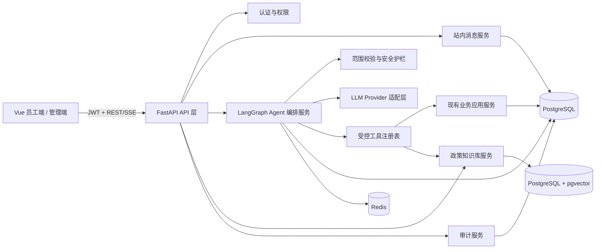
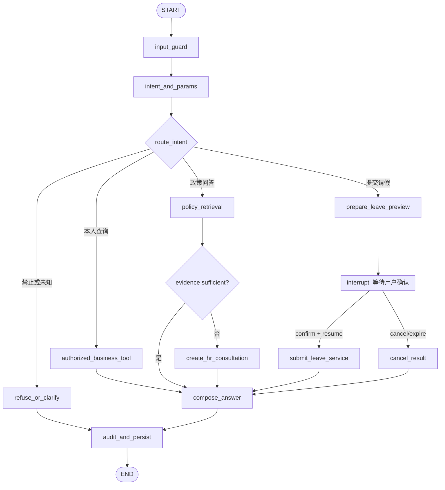
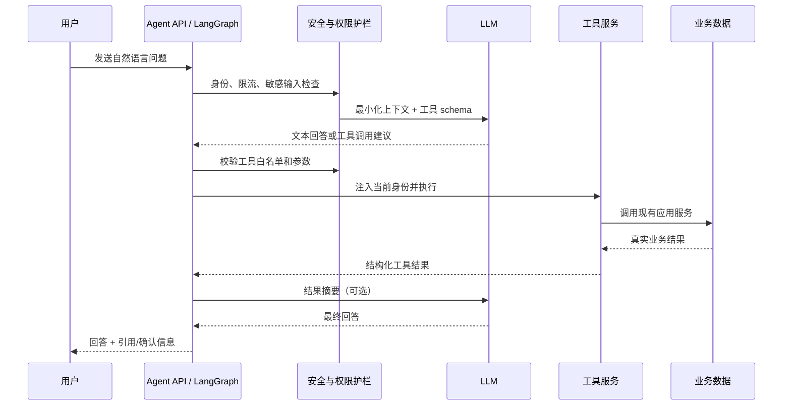
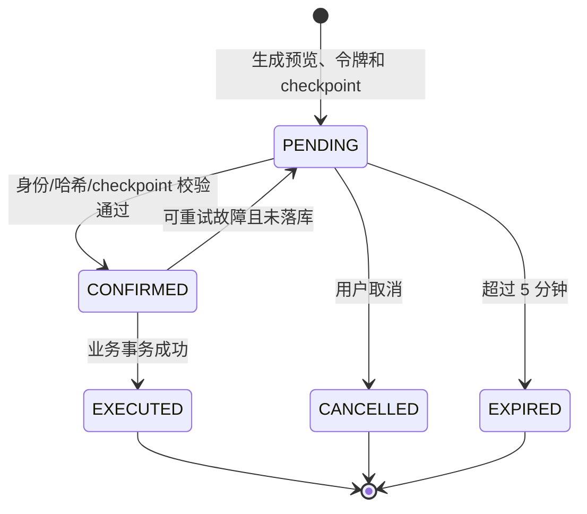

# M10：消息、Agent 与政策问答 IT 实施方案

> 文档状态：关键技术决策已确认，待实施  
> 编制日期：2026-10-10  
> 适用范围：M10-01 至 M10-12  
> 本文用途：确认技术路线、边界和验收标准；评审通过后再进入编码实施。

## 1. 方案结论

M10 在现有 FastAPI 后端中增加基于 **LangGraph 的 Agent 编排模块** 与 **政策知识库模块**，继续复用现有认证、员工、考勤、请假、薪酬、消息及审计能力。LLM 使用 DeepSeek，向量模型使用千问，并通过 Provider 适配层接入。LangGraph 采用显式状态图、受控节点和条件边，不使用可自由调用任意工具的开放式 ReAct Agent。模型不能直接访问数据库、不能自由调用任意 URL，也不能决定数据权限；最终权限和业务校验仍由后端执行。

政策问答采用现有 PostgreSQL + pgvector 的 RAG 方案，不引入独立向量数据库。对数据有修改的 Agent 操作，只开放“本人提交请假”，并执行“预览 -> 用户确认 -> 落库”的二次确认流程。回答采用 SSE 实时输出；无可靠政策依据时，向 HR 发送站内咨询消息。

推荐按以下顺序交付：

1. 补齐站内消息及业务事件通知。
2. 建立 Agent 会话、历史消息和只读工具。
3. 实现请假申请二次确认。
4. 建立政策文档管理、索引、检索和引用。
5. 完成安全、降级、自动化测试及生产观测。

## 2. 目标与非目标

### 2.1 建设目标

- 支持站内消息列表、详情、未读数、单条/全部已读。
- 在请假待审批、审批结果、工资条发布时自动生成消息。
- 员工可与 Agent 多轮对话，并查看本人会话历史。
- Agent 可查询本人考勤、年假余额、请假记录、已发布工资条和员工档案。
- Agent 可在用户二次确认后为本人提交请假申请。
- 管理员可导入和管理政策文档版本。
- Agent 可基于有效政策文档回答问题，并返回可核验的引用来源。
- 无可靠依据、模型不可用或工具失败时给出明确、可恢复的提示。
- Agent 查询和变更操作均可审计、可追踪。

### 2.2 首期不做

- 不允许 Agent 代替任何审批人审批或驳回申请。
- 不允许 Agent 创建、修改或发布薪资数据。
- 不允许查询其他员工的个人、考勤、请假或工资数据。
- 不让模型直接生成 SQL、直接访问数据库或调用任意外部 HTTP 接口。
- 不在首期实现自动学习、自动修改 Prompt 或无人审核的政策发布。
- 不把向量数据库拆成独立服务，除非后续文档量或吞吐量证明 PostgreSQL 无法满足要求。

## 3. 当前基线与差距

| 能力 | 当前基线 | M10 需要补齐 |
| --- | --- | --- |
| 站内消息 | 已有消息列表、单条已读、全部已读等接口 | 核对未读数、详情及三类业务事件的完整性和幂等性 |
| 业务权限 | 已有 JWT、角色和员工身份绑定 | 所有 Agent 工具强制复用当前身份，禁止接收外部 `employee_id` |
| 业务模块 | 员工、考勤、请假、薪酬等 API 已存在 | 抽取可复用应用服务，供 HTTP 路由和 Agent 工具共同调用 |
| Agent 前端 | 员工端已有规则式占位页面 | 接入真实会话、历史、确认交互、引用和异常状态 |
| Agent 数据 | 初始迁移已规划会话、消息、审计等支撑实体 | 实施前核对字段和索引，不足部分追加迁移，不修改已执行迁移 |
| 政策知识库 | 已规划知识库支撑实体 | 补齐上传、解析、版本、切分、向量索引、检索及引用链路 |
| 缓存 | 已有 Redis | 用于限流、短期确认令牌、短期幂等键；核心记录仍写 PostgreSQL |

## 4. 总体架构



关键原则：

- 路由层只处理协议、认证和响应包装，业务逻辑放在应用服务层。
- LangGraph 节点与普通业务 API 调用同一应用服务，避免出现两套权限和规则。
- LLM 只负责意图理解、参数提取和自然语言组织，不作为权限裁决者。
- 所有工具执行结果采用结构化对象，最终回答基于真实工具结果生成。
- 模型输出不可信，必须经过 schema 校验、工具白名单和服务端授权检查。
- LangGraph checkpoint 只保存流程恢复所需状态；业务事实仍以现有业务表为准，不能以图状态替代业务事务。

## 5. 后端模块设计

建议增加或整理以下模块，具体路径可在实施时按现有工程结构微调：

```text
backend/app/
  api/routes/
    agent.py                 # 会话、消息、确认、流式响应
    knowledge.py             # 政策文档与版本管理
  schemas/
    agent.py
    knowledge.py
  services/
    agent/
      graph.py               # LangGraph StateGraph 构建、条件边和编译
      state.py               # 图状态 TypedDict/Pydantic 定义
      nodes.py               # 安全、意图、工具、RAG、确认、回答节点
      orchestrator.py        # 图调用、恢复、SSE 事件适配
      provider.py            # LLM Provider 抽象
      tool_registry.py       # 工具注册、参数校验、权限元数据
      confirmation.py        # 二次确认令牌与幂等
      guardrails.py          # 越权、敏感输入、注入防护
    knowledge/
      ingestion.py           # 文档解析和入库
      chunking.py            # 切分
      embedding.py           # 向量化 Provider
      retrieval.py           # 混合检索与引用
  workers/
    knowledge_indexing.py    # 文档解析/索引后台任务
```

首期可以用 FastAPI `BackgroundTasks` 处理小文档索引，但生产环境推荐独立 worker。为避免首期引入新的消息队列，可使用 PostgreSQL 任务表 + worker 轮询和 `FOR UPDATE SKIP LOCKED`；Redis 仅做加速，不作为不可恢复任务的唯一存储。

### 5.1 LangGraph 使用边界

- 使用 LangGraph `StateGraph` 实现确定性的状态流转和条件分支。
- 使用异步图执行，以便与 FastAPI、异步 SQLAlchemy 和 SSE 集成。
- 使用 PostgreSQL checkpointer 保存 `thread_id` 对应的执行状态，支持断线恢复和二次确认后的继续执行。
- `thread_id` 必须由后端根据当前用户和会话生成并校验，不能信任客户端直接指定的任意值。
- 使用 `interrupt` 暂停请假提交，在用户确认后通过 `Command(resume=...)` 恢复；恢复前仍需校验一次性确认令牌和当前登录身份。
- 不使用可自动发现或调用任意函数的动态工具机制。图中只注册经过审查的固定节点和工具白名单。
- LangGraph 节点不直接操作 ORM；节点调用应用 Service，Service 负责权限、事务、幂等和审计。
- 不把 LangGraph checkpoint 当作业务记录；请假单、消息、审计和政策版本必须持久化到各自业务表。

建议依赖包括 `langgraph`、LangGraph PostgreSQL checkpointer 对应包，以及兼容 OpenAI API 的模型客户端。DeepSeek 和千问仍通过项目自定义 Provider 接口隔离，避免业务节点依赖厂商 SDK。具体版本不在方案阶段写死，实施时根据当前 Python、Pydantic、SQLAlchemy 和 PostgreSQL 驱动执行兼容性验证后锁定到依赖文件及锁文件。

SSE 由 FastAPI `StreamingResponse` 输出 LangGraph 的异步事件流。对外事件类型固定为 `message_delta`、`tool_status`、`citation`、`confirmation_required`、`completed`、`error` 和心跳事件；不得把 LangGraph 内部完整状态、Prompt 或工具敏感参数直接发送给前端。

## 6. 数据模型与迁移

实施前先核对现有模型和初始迁移，遵循“已执行迁移不回改，只新增 Alembic revision”。推荐字段如下。

### 6.1 Agent 会话

`agent_conversations`

| 字段 | 建议类型 | 说明 |
| --- | --- | --- |
| id | UUID/BIGINT | 主键，沿用项目主键规范 |
| user_id | FK | 当前登录用户 |
| employee_id | FK | 会话所属员工，服务端绑定 |
| title | VARCHAR(100) | 首轮内容生成，可人工修改 |
| status | VARCHAR(20) | ACTIVE/ARCHIVED |
| created_at/updated_at | TIMESTAMP | 创建和更新时间 |

索引：`(user_id, updated_at desc)`；所有查询必须同时限定当前 `user_id`。

### 6.2 Agent 消息

`agent_messages`

| 字段 | 建议类型 | 说明 |
| --- | --- | --- |
| id | UUID/BIGINT | 主键 |
| conversation_id | FK | 所属会话 |
| role | VARCHAR(20) | USER/ASSISTANT/TOOL/SYSTEM |
| content | TEXT | 展示文本；敏感信息落库前脱敏 |
| status | VARCHAR(20) | PENDING/COMPLETED/FAILED |
| tool_name | VARCHAR(64) nullable | 工具名称 |
| tool_call_id | VARCHAR(64) nullable | 单次调用标识 |
| tool_args_redacted | JSONB nullable | 脱敏后的参数 |
| tool_result_summary | JSONB nullable | 可审计摘要，不存敏感完整结果 |
| model_name | VARCHAR(100) nullable | 实际模型 |
| prompt_tokens/completion_tokens | INTEGER nullable | 成本观测 |
| latency_ms | INTEGER nullable | 延迟观测 |
| created_at | TIMESTAMP | 创建时间 |

### 6.3 LangGraph checkpoint

使用 LangGraph 官方 PostgreSQL checkpointer 对应的数据表保存图执行状态，并通过 Alembic 或受控初始化步骤管理其创建过程。checkpoint 的 `thread_id` 与 `agent_conversations.id` 建立可追踪映射，调用前同时校验当前 `user_id`。

checkpoint 仅保存恢复流程所需的最小状态，避免写入密码、JWT、API Key、完整身份证号或完整工资明细。checkpoint 与 Agent 会话一起执行 180 天清理；清理必须按会话归属和时间分批执行并记录审计。

### 6.4 二次确认

`agent_confirmations`

| 字段 | 建议类型 | 说明 |
| --- | --- | --- |
| id | UUID | 对外确认令牌使用随机 UUID |
| conversation_id/user_id | FK | 绑定会话和用户 |
| tool_name | VARCHAR(64) | 仅允许可确认的白名单工具 |
| args_snapshot | JSONB | 经服务端规范化后的参数快照 |
| args_hash | VARCHAR(64) | 防止参数被替换 |
| status | VARCHAR(20) | PENDING/CONFIRMED/CANCELLED/EXPIRED/EXECUTED |
| expires_at | TIMESTAMP | 推荐 5 分钟过期 |
| executed_at | TIMESTAMP nullable | 执行时间 |
| result_ref | VARCHAR(100) nullable | 新建业务记录标识 |

Redis 保存短期热点状态和一次性锁，PostgreSQL 保存最终事实，以支持审计和故障恢复。

### 6.5 政策知识库

- `knowledge_documents`：政策逻辑文档，含名称、分类、归属部门。
- `knowledge_document_versions`：版本号、原文件、文件哈希、状态、生效区间、发布人、失败原因。
- `knowledge_chunks`：版本、章节、页码、文本、token 数、metadata、embedding。
- `knowledge_ingestion_jobs`：解析/向量化任务状态、重试次数和错误信息。

文档版本状态：

```text
UPLOADED -> PARSING -> INDEXING -> READY -> PUBLISHED -> ARCHIVED
                   \-> FAILED
```

只有 `PUBLISHED` 且在生效日期内的版本可用于员工问答。同一文档仅允许一个当前发布版本；发布新版本时，在一个数据库事务中归档旧版本。

向量字段建议 `vector(<embedding_dimension>)`，维度由选定 embedding 模型固定。建 HNSW 或 IVFFlat 索引前必须确定维度；更换维度时新建索引版本并重新向量化，不能混存。

### 6.6 消息与审计

- 复用现有站内消息表；增加 `event_type`、`business_type`、`business_id` 和幂等键（如现有字段不足）。
- 唯一约束建议：`(event_type, business_type, business_id, recipient_user_id)`，避免重试生成重复消息。
- 复用现有审计日志；至少记录 actor、employee、conversation、tool、操作类型、结果、request_id、时间和失败原因。
- 审计日志不记录密码、JWT、API Key、完整身份证号、完整工资明细或原始 Prompt 中的敏感值。

## 7. API 设计

沿用项目现有统一响应结构和分页规范。HTTP 状态码表达协议结果，业务 `code` 使用 M10 独立的 `60000-60999` 段，不把业务错误定义在 400 段。

### 7.1 站内消息

| 方法 | 路径 | 用途 |
| --- | --- | --- |
| GET | `/api/messages` | 分页列表，可按未读/类型筛选 |
| GET | `/api/messages/{id}` | 详情，只允许收件人访问 |
| GET | `/api/messages/unread-count` | 当前用户未读数 |
| POST | `/api/messages/{id}/read` | 单条已读，幂等 |
| POST | `/api/messages/read-all` | 全部已读，幂等 |

### 7.2 Agent 会话

| 方法 | 路径 | 用途 |
| --- | --- | --- |
| POST | `/api/agent/conversations` | 新建当前用户会话 |
| GET | `/api/agent/conversations` | 当前用户会话列表 |
| GET | `/api/agent/conversations/{id}` | 会话详情和消息历史 |
| PATCH | `/api/agent/conversations/{id}` | 修改标题或归档 |
| POST | `/api/agent/conversations/{id}/messages` | 发送消息，普通 JSON 响应 |
| GET | `/api/agent/conversations/{id}/stream` | 可选 SSE 流式事件通道 |
| POST | `/api/agent/confirmations/{token}/confirm` | 确认并执行一次写操作 |
| POST | `/api/agent/confirmations/{token}/cancel` | 取消待确认操作 |

发送消息请求只接收 `content` 和客户端幂等键，不接收 `employee_id`、角色或工具名。由服务端根据 JWT 恢复身份并决定是否调用工具。

建议普通响应包含：

```json
{
  "conversation_id": "...",
  "message_id": "...",
  "answer": "您本月有 1 条请假记录。",
  "status": "COMPLETED",
  "citations": [],
  "confirmation": null
}
```

涉及请假提交时不直接落库，而返回：

```json
{
  "answer": "请确认以下请假申请。",
  "status": "AWAITING_CONFIRMATION",
  "confirmation": {
    "token": "随机一次性令牌",
    "expires_at": "2026-10-10T15:05:00+08:00",
    "action": "submit_leave",
    "summary": {
      "leave_type": "年假",
      "start_at": "2026-10-12 09:00:00",
      "end_at": "2026-10-12 18:00:00",
      "duration": "1 天",
      "reason": "个人事务"
    }
  }
}
```

### 7.3 政策文档管理

仅 ADMIN 可调用管理接口：

| 方法 | 路径 | 用途 |
| --- | --- | --- |
| POST | `/api/admin/knowledge/documents` | 创建政策文档并上传首个版本 |
| POST | `/api/admin/knowledge/documents/{id}/versions` | 上传新版本 |
| GET | `/api/admin/knowledge/documents` | 列表及处理状态 |
| GET | `/api/admin/knowledge/documents/{id}` | 版本、错误和索引信息 |
| POST | `/api/admin/knowledge/versions/{id}/publish` | 发布已就绪版本 |
| POST | `/api/admin/knowledge/versions/{id}/retry` | 重试失败任务 |
| POST | `/api/admin/knowledge/versions/{id}/archive` | 归档版本 |

文件限制建议：仅 PDF、DOCX、MD、TXT；单文件默认不超过 20 MB；校验扩展名、MIME 和文件头；文件名由服务端重命名；原文件存储路径不直接暴露给前端。

## 8. Agent 工具协议

### 8.1 工具白名单

| 工具 | 类型 | 数据范围 | 是否二次确认 |
| --- | --- | --- | --- |
| `get_my_attendance` | 查询 | 当前员工 | 否 |
| `get_my_leave_balance` | 查询 | 当前员工 | 否 |
| `list_my_leave_requests` | 查询 | 当前员工 | 否 |
| `get_my_payslip` | 查询 | 当前员工且已发布 | 否 |
| `get_my_profile` | 查询 | 当前员工允许展示字段 | 否 |
| `search_hr_policy` | 查询 | 已发布政策 | 否 |
| `prepare_leave_request` | 预览 | 当前员工 | 生成确认令牌 |
| `submit_leave_request` | 变更 | 当前员工 | 是，仅确认端点触发 |

明确不注册：审批、驳回、代他人请假、工资修改、员工搜索、任意 SQL、任意 HTTP 请求等工具。

### 8.2 统一工具输入输出

每个工具使用独立 Pydantic 输入模型并拒绝额外字段。`employee_id`、`user_id`、角色、数据权限上下文只能由服务端注入。

```json
{
  "tool_call_id": "tc_xxx",
  "tool": "get_my_attendance",
  "arguments": { "month": "2026-10" },
  "context": {
    "user_id": "服务端注入",
    "employee_id": "服务端注入",
    "request_id": "服务端注入"
  }
}
```

统一结果：

```json
{
  "ok": true,
  "code": 0,
  "data": {},
  "display_summary": "2026 年 10 月出勤 8 天",
  "retryable": false
}
```

模型只接收完成回答所需的最少字段。工资条等敏感结果建议由后端生成固定摘要，不把完整明细再次发送给模型。

## 9. LangGraph 状态图与调用流程

推荐图状态只保存流程必需数据：`conversation_id`、`user_message`、服务端身份引用、意图、已校验参数、工具结果摘要、引用、确认状态、错误分类和最终回答。不得让客户端覆盖服务端身份上下文。



条件边只根据后端验证后的枚举状态跳转，不能直接执行模型返回的任意节点名或函数名。



为了降低模型调用次数，简单查询可由节点模板直接渲染结果；复杂组合问题再让模型总结。每轮工具调用设置上限（建议最多 3 次），图同时设置递归上限，避免循环和失控成本。

## 10. 二次确认状态机



确认端点必须做到：

- 令牌随机、短期有效、只能使用一次。
- 绑定当前用户、会话、工具名和规范化参数哈希。
- 绑定 LangGraph `thread_id` 和 checkpoint 标识，禁止用一个会话的令牌恢复另一个会话。
- 确认时重新执行业务校验，例如余额、日期冲突和申请状态。
- 使用数据库事务和幂等键，重复点击返回同一执行结果，不重复创建请假单。
- 前端不可修改预览参数；参数变化必须重新生成预览和令牌。
- 取消或过期不得写入业务表。

## 11. 政策 RAG 设计

### 11.1 导入与索引流程

1. 管理员上传文件，后端校验格式、大小和文件哈希。
2. 保存原文件和版本记录，创建可重试的索引任务。
3. 按格式提取文本，保留标题、章节、页码或段落定位信息。
4. 清洗页眉页脚和重复空白，不改写政策原意。
5. 按标题优先、token 窗口兜底切分；建议 500-800 tokens，重叠 80-120 tokens。
6. 调用 embedding Provider，批量保存向量和 metadata。
7. 抽样检查可检索性，状态转为 READY。
8. 管理员显式发布后，版本才进入员工检索范围。

### 11.2 检索策略

- MVP 使用向量检索 + PostgreSQL 全文/关键词检索的混合召回。
- 先过滤租户/组织（若未来引入）、文档状态、生效时间和权限，再做相似度排序。
- 默认召回 8 个片段，去重/重排后提供最多 4 个上下文片段给模型。
- 设置最低相关度阈值；低于阈值不让模型猜测，返回“未找到可靠政策依据”。
- 回答必须携带结构化引用：文档名、版本、章节、页码/段落、chunk_id。
- 前端引用可展开查看原文片段；不得用模型编造的字符串作为引用。

### 11.3 无依据处理

满足任一条件即不生成确定性政策结论：无召回结果、相关度不足、多个有效政策冲突、文档尚未发布、模型调用失败。系统返回统一提示，并创建一条发给 HR 的站内咨询消息。消息应包含提问摘要、提问员工、会话标识、创建时间和原 Agent 会话跳转信息，但不得包含密码、令牌等敏感数据；同一会话中的相同问题应使用幂等键防止重复发送。

员工端应明确显示“未找到可靠政策依据，已转交 HR”，并允许员工在站内消息中接收 HR 后续反馈。

## 12. 消息事件设计

业务服务在事务成功后写入 outbox 事件，后台消费者创建站内消息，可避免“业务成功但消息丢失”。若 MVP 暂不引入 outbox，至少在同一数据库事务中创建业务记录和消息记录，并以唯一幂等键防重。

| 事件 | 收件人 | 触发时机 | 跳转目标 |
| --- | --- | --- | --- |
| `LEAVE_APPROVAL_PENDING` | 当前审批人 | 请假申请提交成功 | 管理端待审批详情 |
| `LEAVE_APPROVED` / `LEAVE_REJECTED` | 申请员工 | 审批事务成功 | 员工端请假详情 |
| `PAYSLIP_PUBLISHED` | 工资条所属员工 | 工资条状态转为已发布 | 员工端工资条详情 |

消息正文只放摘要，不放完整工资数据等敏感内容。详情页仍通过有权限校验的业务接口获取实时数据。

## 13. 权限与安全

### 13.1 身份和数据范围

- API 从 JWT 获取 `user_id`，再从数据库确定角色和绑定的 `employee_id`。
- 工具调用不接受客户端或模型提供的 `employee_id`。
- 即使 ADMIN 在员工自助端使用 Agent，也默认只查询管理员本人绑定的员工档案；管理查询继续通过管理端业务页面完成。
- 工资条只允许读取本人且状态为已发布的数据。
- 会话、消息、确认令牌均校验所属用户，不能仅凭 ID 查询。

### 13.2 模型与 Prompt 安全

- 系统指令、工具结果和用户输入分角色传递，不拼接成不可区分的单段文本。
- 政策文档内容按不可信数据处理，忽略其中要求泄露 Prompt、改变权限或调用工具的指令。
- 限制输入长度、附件类型、单轮工具次数、会话历史长度和模型超时。
- API Key 仅放服务端环境变量，不写入代码、数据库、前端包或日志。
- 发送给外部模型前做字段最小化和敏感数据脱敏。
- 对疑似密码、访问令牌、身份证、银行卡等敏感输入提示用户不要提交，并按配置决定拒绝或脱敏处理。

### 13.3 审计事件

至少记录：会话创建、消息提交、每次工具调用、越权拒绝、确认生成、确认/取消、请假落库、知识库上传/发布/归档、模型失败和人工转接。日志通过 `request_id`、`conversation_id` 和 `tool_call_id` 串联。

## 14. 异常、降级与业务错误码

建议补充以下 M10 业务码；最终编号与现有 `60000-60999` 登记表合并，避免占用已存在编号：

| 业务码 | 标识 | 场景 |
| --- | --- | --- |
| 60001 | `AGENT_UNAVAILABLE` | Agent 服务暂不可用 |
| 60002 | `AGENT_SCOPE_FORBIDDEN` | 越权或禁止操作（已有规划） |
| 60003 | `AGENT_TOOL_NOT_ALLOWED` | 工具未注册或当前身份不可用 |
| 60004 | `AGENT_TOOL_FAILED` | 工具执行失败 |
| 60005 | `AGENT_CONFIRMATION_REQUIRED` | 操作必须二次确认 |
| 60006 | `AGENT_CONFIRMATION_INVALID` | 令牌不存在、身份不匹配或参数被修改 |
| 60007 | `AGENT_CONFIRMATION_EXPIRED` | 确认令牌已过期 |
| 60008 | `AGENT_CONFIRMATION_USED` | 确认令牌已消费 |
| 60009 | `AGENT_RATE_LIMITED` | 当前用户请求过频 |
| 60010 | `AGENT_SENSITIVE_INPUT` | 检测到禁止处理的敏感输入 |
| 60101 | `KNOWLEDGE_FILE_UNSUPPORTED` | 文件类型不支持 |
| 60102 | `KNOWLEDGE_FILE_TOO_LARGE` | 文件超过限制 |
| 60103 | `KNOWLEDGE_INDEXING_FAILED` | 解析或索引失败 |
| 60104 | `KNOWLEDGE_NOT_READY` | 文档尚不可发布/检索 |
| 60105 | `KNOWLEDGE_NO_EVIDENCE` | 无可靠政策依据 |
| 60106 | `KNOWLEDGE_VERSION_CONFLICT` | 发布版本冲突 |

HTTP 层仍可正常使用 400/401/403/404/409/422/429/500/503；这里的要求是响应体中的**业务错误码**不落入 400 段。

降级策略：

- 模型超时：不自动执行任何变更，返回可重试提示和 `request_id`。
- 工具失败：保留工具错误分类，不让模型改写为“成功”。
- embedding 不可用：文档保持 FAILED/待重试，旧的已发布版本继续服务。
- Redis 不可用：限流可按策略降级；确认操作以 PostgreSQL 为准，不能绕过确认。
- RAG 无依据：不输出推测答案，转人工。

## 15. 环境变量

`.env.example` 只提供键和安全示例，真实密钥写在本地 `.env` 或部署平台 Secret 中，`.env` 不提交 Git。

```dotenv
# LLM：DeepSeek（OpenAI-compatible）
LLM_BASE_URL=https://api.example.com/v1
LLM_API_KEY=
LLM_MODEL=
LLM_TIMEOUT_SECONDS=30
LLM_MAX_TOOL_CALLS=3

# Embedding：千问向量模型
EMBEDDING_BASE_URL=https://api.example.com/v1
EMBEDDING_API_KEY=
EMBEDDING_MODEL=
EMBEDDING_DIMENSION=1536

# Agent
AGENT_ENABLED=false
AGENT_GRAPH_RECURSION_LIMIT=12
AGENT_CONFIRMATION_TTL_SECONDS=300
AGENT_MAX_INPUT_CHARS=4000
AGENT_RATE_LIMIT_PER_MINUTE=20

# Knowledge
KNOWLEDGE_STORAGE_PATH=/app/data/knowledge
KNOWLEDGE_MAX_FILE_MB=20
KNOWLEDGE_RETRIEVAL_TOP_K=8
KNOWLEDGE_CONTEXT_TOP_K=4
KNOWLEDGE_MIN_SCORE=0.70
```

不建议把密钥直接写在 `docker compose up` 命令行。DeepSeek 和千问的真实 Base URL、API Key、模型名称写入项目根目录 `.env`，生产环境改用 Docker Secret 或部署平台 Secret，不提交 Git。`AGENT_ENABLED=false` 作为发布开关，迁移和配置验证通过后再开启。千问向量模型的实际维度必须写入 `EMBEDDING_DIMENSION`，并与 pgvector 列定义保持一致。

## 16. 部署方案

### 16.1 服务拓扑

- `frontend`：现有 Vue 构建产物。
- `nginx`：现有统一入口和 SSE 反向代理配置。
- `backend`：API、LangGraph 编排、SSE 和普通查询。
- `agent-worker`：推荐新增，同一后端镜像，不同启动命令，处理文档索引任务。
- `postgres`：使用现有 PostgreSQL，已确认安装 pgvector 扩展。
- `redis`：限流、短期锁和缓存。

实施前仍需通过 SQL 检查 pgvector 扩展版本及可用性，并根据千问向量模型的实际维度创建向量列和索引。现阶段不引入 Qdrant 等独立向量数据库。

### 16.2 上线顺序

1. 备份数据库，部署新增环境变量但保持 `AGENT_ENABLED=false`。
2. 执行 Alembic 迁移并验证 pgvector 扩展。
3. 启动/更新 backend 与 worker，执行健康检查。
4. 上传一份测试政策并完成索引、检索和引用验证。
5. 部署前端，使用测试员工进行权限和二次确认验收。
6. 小范围开启 Agent，再逐步开放。

上线前需把具体 Docker、迁移、初始化、回滚和检查命令补入项目部署文档，与此前“所有部署步骤可复现”的要求保持一致。

## 17. 前端方案

### 17.1 员工端 Agent

- 左侧会话列表，支持新建、重命名和归档。
- 主区展示用户消息、Agent 回答、工具执行状态和失败重试。
- 工资等敏感信息使用现有业务组件或固定结果卡片展示，避免模型生成不可靠格式。
- 写操作显示明确的确认卡片，包含全部关键字段、确认和取消按钮、过期状态。
- 政策回答在正文后展示引用列表，可展开原文片段。
- 无依据时显示“已转交 HR”的处理结果，不把“未找到”渲染成普通答案。
- Agent 回答使用 SSE 实时展示，并提供连接中断后的重试及普通错误响应。

### 17.2 管理端知识库

- 文档列表：名称、分类、当前版本、状态、生效日期、更新时间。
- 上传/新版本：格式和大小校验、版本说明、生效日期。
- 详情：各版本、处理进度、失败原因、重试、发布和归档。
- 发布操作二次确认；只有 READY 版本可以发布。

## 18. 测试与验收

### 18.1 自动化测试

- 单元测试：参数 schema、工具白名单、范围校验、确认状态机、文本切分和引用组装。
- LangGraph 测试：各节点、条件边、递归上限、checkpoint 隔离、interrupt/resume、取消/过期后不可恢复。
- API 集成测试：会话隔离、消息已读、三类业务通知、知识库状态转换。
- 权限测试：伪造 `employee_id`、访问他人会话/工资条、ADMIN 在 Agent 中查询他人、代审批、改薪资。
- 幂等测试：重复业务事件、重复确认、并发确认、超时后确认。
- RAG 测试：命中、无依据、过期版本、冲突版本、引用页码/段落正确性。
- 故障测试：模型超时、模型非法工具、工具失败、Redis 不可用、embedding 失败、worker 重试。
- E2E：员工提问、SSE 实时接收、查看引用、查询本人数据、预览并确认请假、取消请假预览、无依据时发送 HR 咨询消息、管理员上传并发布政策。

模型相关测试使用 fake provider 固定返回，保证 CI 稳定；另设需真实密钥才运行的 smoke 测试，不作为普通 CI 的硬依赖。

### 18.2 核心验收标准

- 用户 A 无法通过任何参数、Prompt 或 URL 读取用户 B 的数据。
- Agent 不能执行未注册工具，不能审批、修改薪资或查询他人。
- 请假申请在用户确认前数据库无新增记录；重复确认最多创建一条。
- 请假待办、审批结果、工资条发布消息准确送达且无重复。
- 政策回答均有真实、可展开的引用；无证据时明确拒答并引导人工处理。
- 模型或工具失败不会展示虚假成功，不会导致未确认写入。
- 所有工具调用、拒绝和确认操作可按 request_id 完整审计。
- Agent 会话、消息和审计数据按 180 天保留策略清理，清理任务本身有审计记录。

## 19. 分阶段实施任务与估算

以下为 1 名熟悉现有项目的全栈开发者的净开发日估算，不含外部模型账号审批、政策资料整理及业务方等待时间。

| 阶段 | 对应任务 | 主要产出 | 估算 |
| --- | --- | --- | --- |
| A 消息补齐 | M10-01、M10-02 | 消息接口、事件触发、幂等、前端未读状态 | 2-3 人日 |
| B Agent 基础 | M10-03、M10-04、M10-05 | LangGraph 状态图、checkpoint、Provider、只读工具、SSE、员工端真实对话 | 6-8 人日 |
| C 安全写操作 | M10-06、M10-07、M10-08 | 确认状态机、请假提交、审计、越权拒绝 | 3-4 人日 |
| D 政策 RAG | M10-09、M10-10、M10-11 | 管理端知识库、worker、pgvector、引用和转人工 | 6-8 人日 |
| E 稳定性验收 | M10-12 | 降级、限流、观测、自动化测试、部署文档 | 3-5 人日 |

总估算：**20-28 人日**。若已有数据表、消息事件和审计能力可直接复用，可减少约 2-4 人日；若政策 PDF 以扫描件为主且未来需要 OCR，则需另行增加工作量。

## 20. 依赖与风险

| 风险/依赖 | 影响 | 应对 |
| --- | --- | --- |
| DeepSeek/千问接口配置不一致 | 鉴权、限流和错误格式可能不同 | 分别实现 Provider 适配器并用契约测试验证 |
| 千问向量模型维度未写入配置 | 无法正确创建向量列和索引 | 实施前确认具体模型名和维度，迁移中固定维度 |
| 扫描 PDF 无文本层 | 无法直接检索 | 首期拒绝并提示；需要时单独引入 OCR |
| 政策版本和生效规则不清 | 可能引用过期政策 | 发布必须显式操作并维护生效区间 |
| 模型幻觉或 Prompt 注入 | 错误回答、越权企图 | 工具白名单、后端鉴权、引用门槛、无依据拒答 |
| 敏感数据发往第三方模型 | 合规风险 | 数据最小化、脱敏、供应商协议；必要时使用内网模型 |
| 对话成本和延迟 | 用户体验及费用不可控 | 限流、上下文裁剪、模板化简单结果、调用次数上限 |
| LangGraph/checkpointer 版本兼容 | 与 Python、Pydantic、SQLAlchemy 或 PostgreSQL 驱动不兼容 | 固定依赖版本，先做异步 checkpoint、interrupt/resume 和 SSE 技术验证 |

## 21. 已确认的评审决策

以下 9 项已于 2026-10-10 确认，作为后续实现和验收依据：

| 序号 | 决策项 | 确认结果 | 实施约束 |
| --- | --- | --- | --- |
| 1 | 模型接入 | LLM 使用 DeepSeek，向量模型使用千问 | 分别通过 Provider 适配层接入；密钥只保存在服务端环境变量中 |
| 2 | 向量存储 | 使用现有 PostgreSQL + pgvector | 不引入独立向量数据库；实施前核验扩展版本、模型维度和索引能力 |
| 3 | 写操作范围 | 只开放提交本人请假 | 必须二次确认；不开放修改、撤销、审批、薪资修改或代他人操作 |
| 4 | 人工转接 | 给 HR 发送站内咨询消息 | 无可靠政策依据时自动创建幂等咨询消息，并向员工显示已转交状态 |
| 5 | 文档格式 | 暂不支持 OCR | 支持带文本层的 PDF 及 DOCX/MD/TXT；扫描 PDF 明确提示不支持 |
| 6 | 输出方式 | 使用 SSE 实时响应 | 保留普通错误响应和断线重试机制；反向代理必须关闭不当缓冲并延长超时 |
| 7 | 数据保留 | 180 天 | Agent 会话、消息及审计数据保留 180 天，到期由定时任务清理并记录清理审计 |
| 8 | 管理员边界 | 采用推荐方案 | ADMIN 使用员工 Agent 时也只能访问本人数据；管理查询继续使用管理端页面 |
| 9 | Agent 编排框架 | 使用 LangGraph | 使用显式 StateGraph、受控节点、PostgreSQL checkpoint 和 interrupt/resume；不使用开放式 ReAct Agent |

上述决策如需变更，应先更新本文档，并评估数据库迁移、权限、安全、合规及测试范围的影响。

## 22. 建议的实施准入条件

进入 M10 编码前还需完成以下准备工作：

- 将 DeepSeek 和千问的 Base URL、API Key、具体模型名配置到开发/测试环境，且测试数据不包含真实生产敏感信息。
- 确认千问向量模型维度，并检查 PostgreSQL 版本、pgvector 扩展版本和索引能力。
- 固定与当前 Python、FastAPI、Pydantic、SQLAlchemy 和 PostgreSQL 驱动兼容的 LangGraph/checkpointer 版本，并先完成异步 checkpoint、interrupt/resume 与 SSE 技术验证。
- 准备至少 3 份可用于测试的政策文档及预期问答样例。
- 明确站内咨询消息的 HR 收件人规则（固定 HR、HR 角色全体或按部门分配）及 HR 回复入口。
- 对现有消息、Agent、知识库、审计模型和迁移完成一次代码核对，并形成差异清单。
